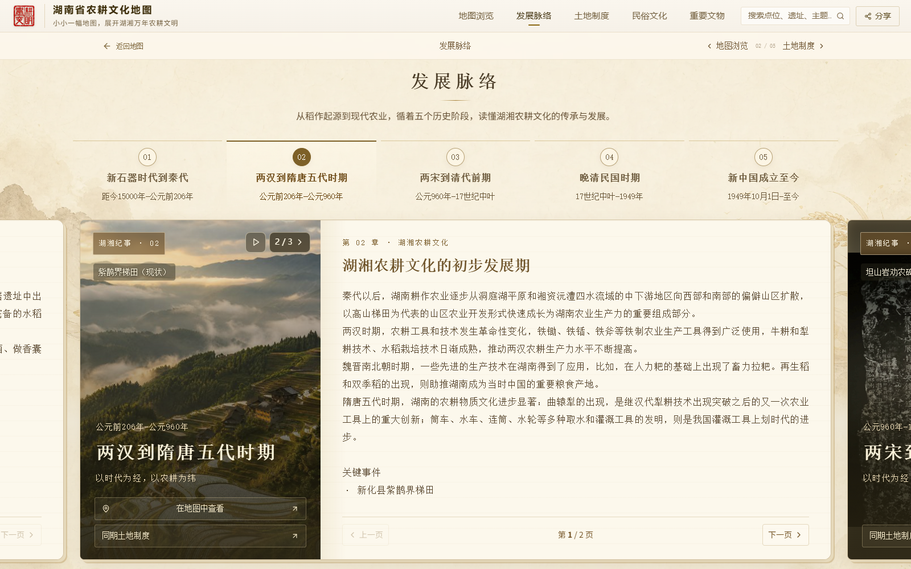
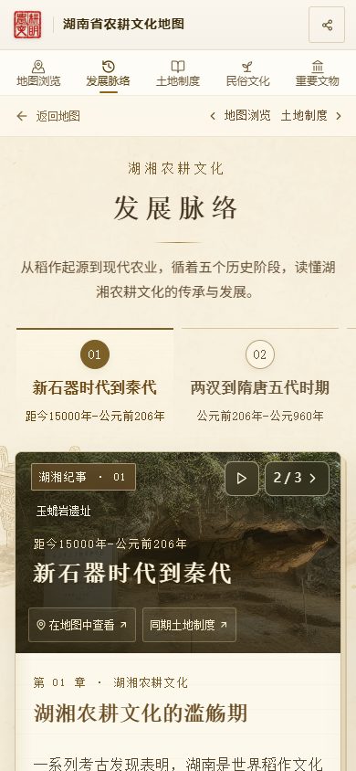

# CSZ2 独立副本：发展脉络图片轮播

日期：2026-10-12。

用户要求新建仓库副本，只在副本修改。新仓库为 `AsukaNeko-39/csz2-timeline-slideshow`，基于原项目 `68563c8e5e299d3a3f00156ba57f0c4288c69dbe`；原源码和原公开网站保持原样。

## 本次效果

发展脉络五张时代卡片的左侧图片区，鼠标移入后每 2.8 秒轮播，使用 0.7 秒淡入过渡。移开后停止并回到第一张。右上角显示张数，支持暂停、手动下一张及主动播放；触屏可点击操作。

自动播放仅在当前卡片可见、网页位于前台时工作；减少动态效果设置下不因悬停自动播放。已加载图片才进入循环，单张图片加载失败时使用可用图片。标题、时代信息、跳转按钮和右侧正文分页保持固定。

| 阶段 | 轮播图片（全部来自现有项目资料） |
| --- | --- |
| 新石器时代到秦代 | 炭化稻谷、玉蟾岩遗址、城头山遗址 |
| 两汉到隋唐五代时期 | 铁质耕具、紫鹊界梯田现状、三国吴简佃田课赋 |
| 两宋到清代前期 | 坦山岩劝农碑、陈旉《农书》、宋元明清农耕文献汇集 |
| 晚清民国时期 | 太平天国田凭、“义仓永定章程”石碑、民国时期湖南人口与耕地资料 |
| 新中国成立至今 | 杂交水稻、土地改革布告、十八洞村 |

文献与器物采用完整前景配合原图模糊背景，风景采用铺满取景。图片说明区分现状照片与历史资料；沿用资料库中的跨时期文献汇集，不将其中全部文献断代为某一朝代。

## 验证与交付

- 五个阶段逐一检查图片加载、完整循环、暂停、下一张、移出复位。
- 检查减少动态效果、390 像素手机布局、触屏切图、正文翻页保留、首图失败回退。
- TypeScript 检查、14 项现有导航测试及生产构建通过。
- 新仓库 `main` 保存源码，`gh-pages` 保存公开网页构建；只使用新仓库远端。
- 原历史 PDF 保留，本次新增图文记录；设计文档、维护快照和本地预览入口同步到副本。

桌面轮播第二张：

手机手动切图：

