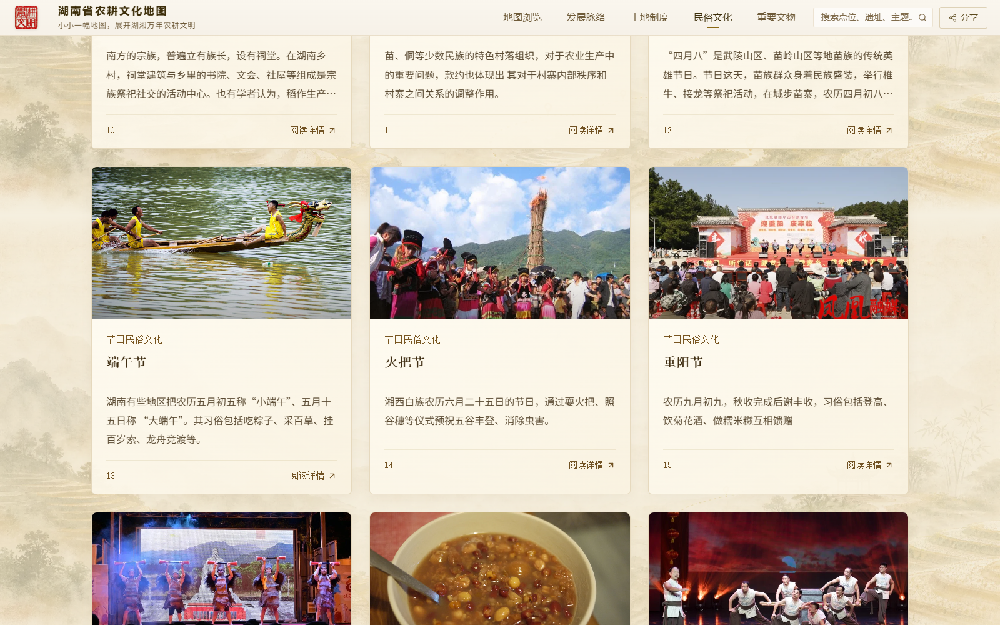
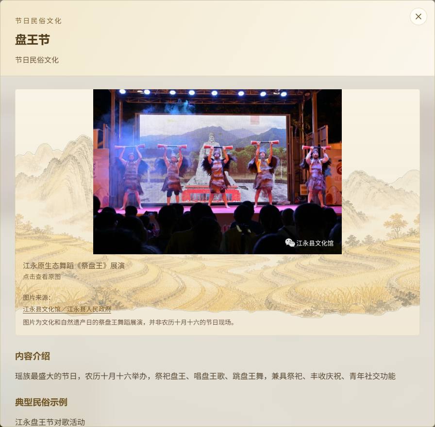
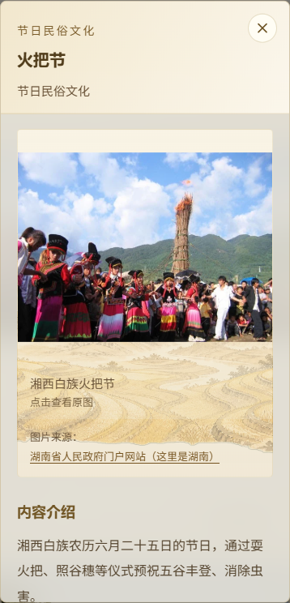

# CSZ2 副本：民俗文化补图与全站图片检查

日期：2026-10-13。修改与发布仅限 `csz2-timeline-slideshow` 副本。

用户截图中的重复山水书本图是无配图条目的占位背景，并非图片请求失败。查明民俗文化19项中7项未配置图片；土地制度9项、重要文物22项原有配图均存在。此次补齐7项，缩略图和详情共用同一份本地素材，详情保留完整图片。

## 新增素材与来源

本次没有生成或虚构历史照片。保留来源水印，最长边限制为1400px，未放大低分辨率原图，统一 WebP 压缩。新增7张合计约744KB。详细页面显示来源；表演、展厅与生产场景按其实际性质说明。

### folk-8 · 怀化民间契约文书展厅（相关资料）

- 文件：`client/public/materials/folk-supplements/fenjia.webp`
- 来源：[红网怀化站 · 卓东](https://hh.rednet.cn/content/646655/68/12084796.html)
- 说明：展览含分家析产类文书，图片为展厅场景，并非某一份分家契约的辨认图。本文为怀化站原创文章，转载请附上原文出处链接和本声明。

### folk-14 · 湘西白族火把节

- 文件：`client/public/materials/folk-supplements/huoba.webp`
- 来源：[湖南省人民政府门户网站（这里是湖南）](https://www.hunan.gov.cn/hnszf/jxxx/hxwh/gms/201711/t20171111_4685352.html)

### folk-15 · 凤凰腊尔山“迎重阳·庆丰收”活动

- 文件：`client/public/materials/folk-supplements/chongyang.webp`
- 来源：[湖南省文化和旅游厅 · 凤凰融媒](https://whhlyt.hunan.gov.cn/whhlyt/news/sxxw/202310/t20231027_31721498.html)

### folk-16 · 江永原生态舞蹈《祭盘王》展演

- 文件：`client/public/materials/folk-supplements/panwang.webp`
- 来源：[江永县文化馆／江永县人民政府](https://www.jiangyong.gov.cn/jiangyong/ggwhfw/202306/b58b1cd3c8fb45bab06c0ef2b7bc7dc1.shtml)
- 说明：图片为文化和自然遗产日的祭盘王舞蹈展演，并非农历十月十六的节日现场。

### folk-17 · 腊八粥（节日食俗示例）

- 文件：`client/public/materials/folk-supplements/laba.webp`
- 来源：[bfishadow / Wikimedia Commons](https://commons.wikimedia.org/wiki/File:Laba_Congee._After.jpg)
- 许可：[CC BY 2.0](https://creativecommons.org/licenses/by/2.0/)；署名 bfishadow。
- 说明：食俗示例，不特指湖南某地。图片已缩小尺寸并转为 WebP。

### folk-18 · 表演唱《安乡硪歌》

- 文件：`client/public/materials/folk-supplements/geyao.webp`
- 来源：[红网常德站 · 曾鑫、王兆龙、陈功](https://cd.rednet.cn/content/646945/64/14642730.html)

### folk-19 · 衡阳春耕稻田（农谚相关生产场景）

- 文件：`client/public/materials/folk-supplements/nongyan.webp`
- 来源：[湖南日报／华声在线 · 刘欣荣](https://hunan.voc.com.cn/news/202302/23033337.html)
- 说明：衡阳县台源镇台九村农机翻耕稻田，展示农谚所源的生产经验，非方言采集现场。

## 验证

- 类型检查通过，GitHub Pages 子目录构建通过。
- 全部146个本地图片文件：尺寸与实际解码成功；预览服务逐文件HTTP读取并再次解码成功。
- 民俗文化19张、土地制度9张、重要文物22张，共50张卡片及所有详情图片在浏览器实际解码通过，没有剩余无图条目。
- 发展脉络5阶段共15张轮播图、土地互动9时代配图通过；地图15个点位封面在实际详情面板检查通过。
- 新增7项来源链接与腊八粥许可链接可访问；390px手机布局无横向溢出，详情完整展示配图。
- 浏览器页面未发现脚本错误或图片HTTP错误。
- 发布后匿名核对 release.json、146张图片以及卡片、详情、轮播和时代配图。
- 原源码 `-CSZ1` 和原发布仓库 `-CSZ1-pages` 的提交保持不变。

