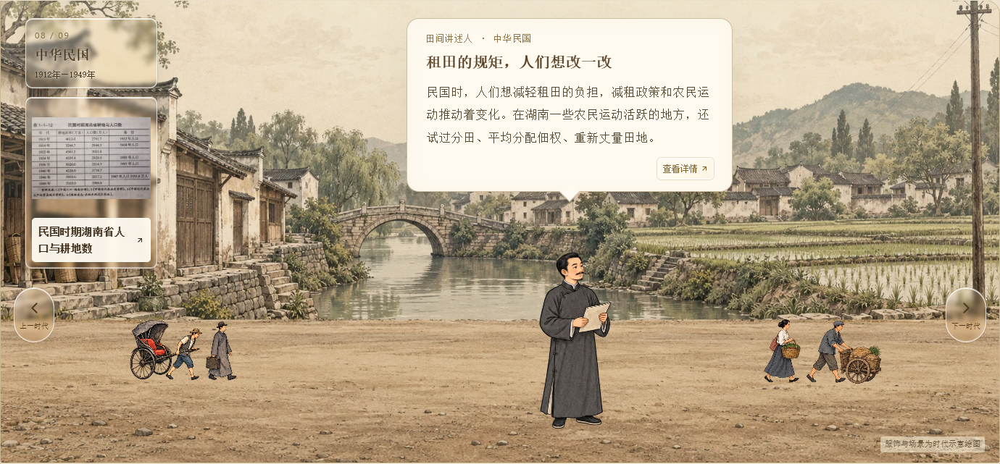
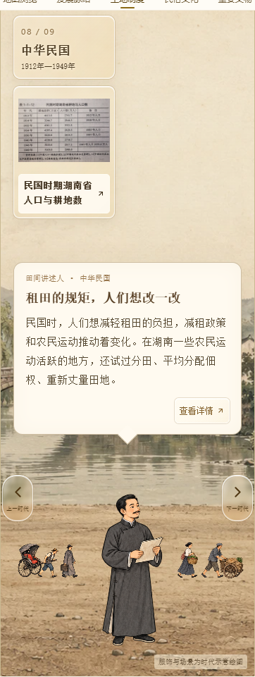

# CSZ2 副本：左侧资料卡片文字可读性

日期：2026-10-12。仅维护 csz2-timeline-slideshow 副本。

用户反馈左侧悬浮资料卡片文字看不清。图注改成深棕色 #382916、600字重，桌面14px、手机13px；图注下面增加约95%不透明的浅色底条，保证深浅背景下均可辨读。仅文字区增加底色，卡片外框保留高透明液态玻璃效果，原资料图不修改。

手机对话框向下留出50px额外空间，避免长图注换行后重叠。九个时代在1600、768、640、390、320px宽度检查：图注完整显示，图片卡片、对话框和切换按钮不重叠，页面无横向溢出。Pages子路径构建通过。

