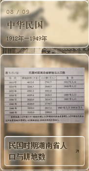
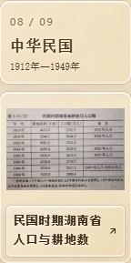

# CSZ2 副本：图注与时间卡片统一玻璃效果

日期：2026-10-12。仅修改并发布 csz2-timeline-slideshow 副本。

用户明确要求替换上一版图注白底，改为与上方时间卡片一样。图注复用时间卡片的半透明渐变、3px模糊与饱和度、白色边缘及玻璃投影；移除约95%不透明浅色底。保留深棕色#382916、600字重及桌面14px/手机13px，使用与时间卡片一致的浅色柔和文字阴影。

图片、布局、点击详情、手机间距及时代切换保持。浏览器核对图注和时间卡片的渐变、模糊、边缘、投影、文字阴影一致；桌面及手机无溢出和重叠，资料图片点击仍打开对应详情。Pages子路径构建通过。

