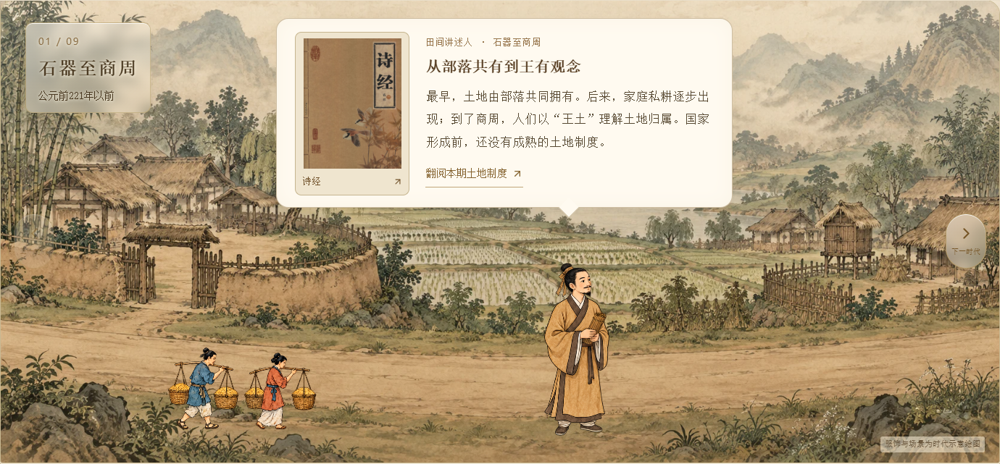
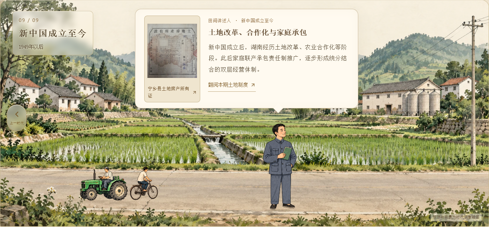
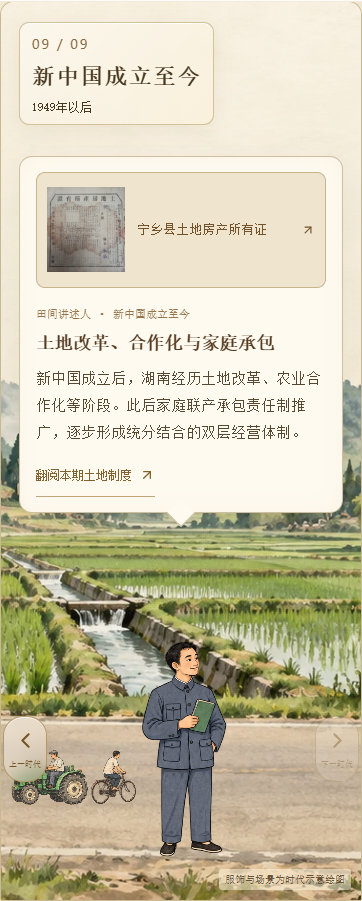
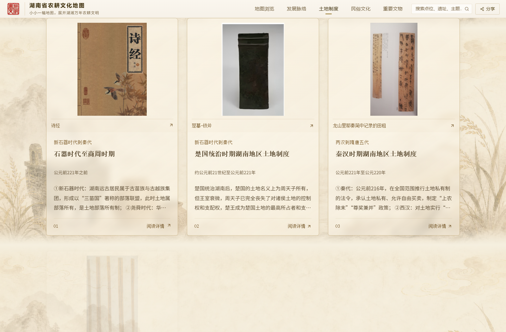

# CSZ2 副本：土地制度图片对话与半透明界面

日期：2026-10-12。维护仓库：AsukaNeko-39/csz2-timeline-slideshow。

按用户最后补充，对话框不做半透明。桌面对话框从450px向左扩展到630px，右侧位置保留；左侧加入当前土地制度资料卡的首张原图，右侧显示人物介绍。九个时代分别匹配现有资料，图片完整展示，不裁剪原图；点击图片或“翻阅本期土地制度”均打开对应资料详情。切换前预加载背景和资料图。

时代标牌、上一时代/下一时代按钮、底部时代节点、分类筛选和原资料卡采用暖色半透明表面、柔和模糊、亮边与棕金描边。字体与实物图片保持完全不透明，选中和禁用状态仍能区分。对话框继续使用不透明宣纸底色。

手机采用上方资料缩略图与下方介绍的纵向布局；左右切换按钮移至人物两侧。画面高度随屏幕调整，留出人物空间。背景、人车先退场、人物随后退场的分层顺序及中山装形象保持。

验证：九个时代的原图均加载成功；1600、1024、768、640、390、360、320px宽度下无横向溢出，标牌、对话与人物无重叠。匹配详情、搜索筛选、分层切换和减少动态效果检查通过。类型检查与Pages子路径构建通过。仅发布到副本仓库，原源码和原网站不修改。

