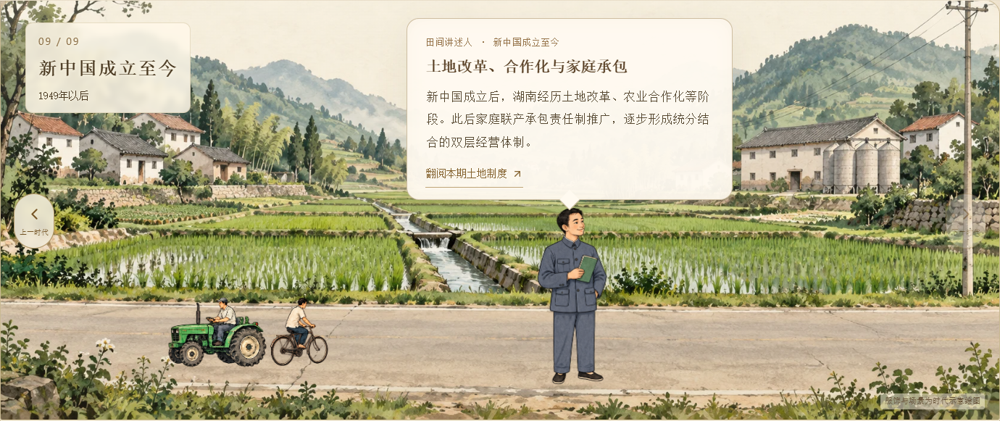
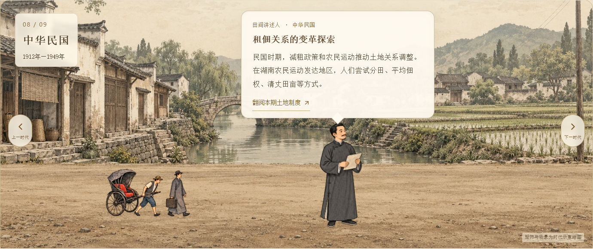
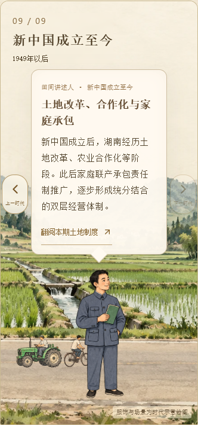
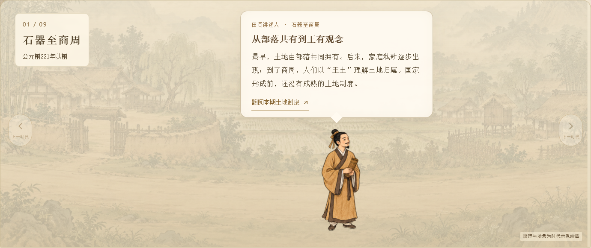

# CSZ2 副本：土地制度 · 田间问古

日期：2026-10-12。维护仓库：AsukaNeko-39/csz2-timeline-slideshow；原项目和原网站不修改。

用户确认在页面上方新增互动模块，下面保留资料卡。九个时代沿一条田间路呈现，人物穿代表时代服饰，手持竹简、纸卷或书册，头顶对话框介绍该期土地制度。“翻阅本期土地制度”打开对应原资料详情。

## 时代与画面

| 时期 | 人物与书简 | 环境与活动 |
| --- | --- | --- |
| 石器至商周 | 商周代表装束、木竹简册示意 | 聚落、稻田、挑担行人 |
| 楚国时期 | 楚地深衣、竹简 | 楚地乡村、牛车 |
| 秦汉 | 交领袍服、田租简册 | 田地与粮仓、木车 |
| 三国两晋南北朝 | 宽袖袍服、纸卷 | 田庄、山地开垦、牛车 |
| 隋唐五代 | 唐代圆领袍与幞头、田令纸卷 | 灌溉田野、水车、驮运队伍 |
| 宋元 | 宋代代表士人、纸本农书 | 水墨梯田、集市推车 |
| 明清 | 明代代表士人、账册 | 田庄、官民田地示意、粮车 |
| 民国 | 长衫、印刷资料册 | 近代乡村、人力车、旧画报色调 |
| 新中国成立至今 | 用户指定中山装、土地资料册 | 现代乡村、拖拉机、自行车、现代水墨色调 |

概括跨越多个朝代的节点只取代表形象；不将竹简归于石器时代，不把所有宋元或明清服饰说成相同。新模块楚国节点使用“春秋战国·楚国统治时期”文字，不扩散旧卡片中存在歧义的世纪范围。原资料正文未改。

服饰方向参考[中国国家博物馆古代服饰文化展](https://www.chnmuseum.cn/portals/0/web/zt/202102gdfsh/)及[故宫博物院服饰研究](https://www.dpm.org.cn/Uploads/File/2019/11/25/u5ddbb3f9e989e.pdf)，人物与背景属于解释性绘图，不作精确服饰考古复原。

## 分层切换与交互

1. 背景、人车活动先淡出；小人和对话框暂留。
2. 小人与对话框随后退场。
3. 新时代背景铺开，留出短暂停顿。
4. 新人物出现，介绍略晚浮现；总计约1.78秒。

支持左右按钮、九节点选择、键盘方向键。首尾按钮有边界，切换期间禁止重复启动。图片预加载后开始退场，减少动态效果设置下不播放过渡。手机支持横滑时代节点，人物、对话框和44px左右按钮分开布局。

## 绘图来源与编辑要求

使用内置图片生成工具，新增两张3×3透明图集（九人物、九组道路活动）及九张独立16:9田间背景。所有资源已复制到项目 materials/land-journey 中，保留Alpha并转换为WebP。没有以既有实物照片冒充生成历史图像。

最终提示词组：共同采用古画、水墨与矿物色笔触、宣纸质感、克制的赭色/灰绿/靛蓝，不用3D或动漫，不生成文字。九背景按上表匹配代表时代建筑与农田，保持下方横贯空路和上方对话留白，背景不包含人物车辆。九人物图集各占等大格、全身居中、脚部对齐、服装和书简逐代改变，透明背景；最后一格再定向编辑为灰蓝中山装（立领、四贴袋、五扣、配套裤装），保留其余八格。九活动图集分别描绘上表人车，透明背景，不能跨格或带背景。可见原画对应用户要求的时代示意，原素材不替换。

## 验证

九个节点与图片、分层顺序、首尾边界、匹配详情、原有筛选均检查；390、360、768像素布局检查了对话与人物不重叠和页面不溢出。减少动态效果与键盘方向键另行检查，类型检查、生产构建与既有导航测试通过。截图见下。

