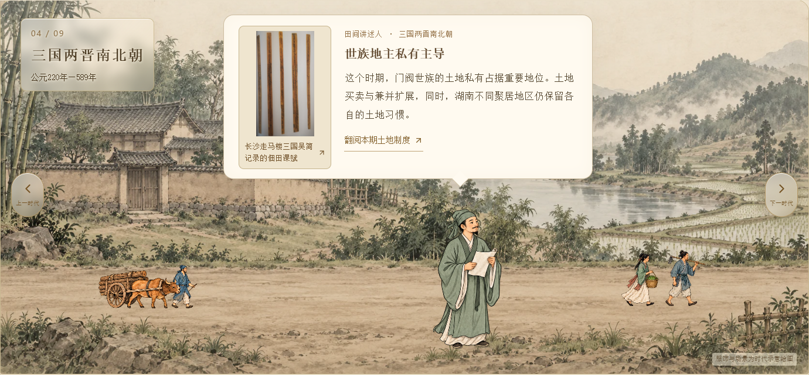
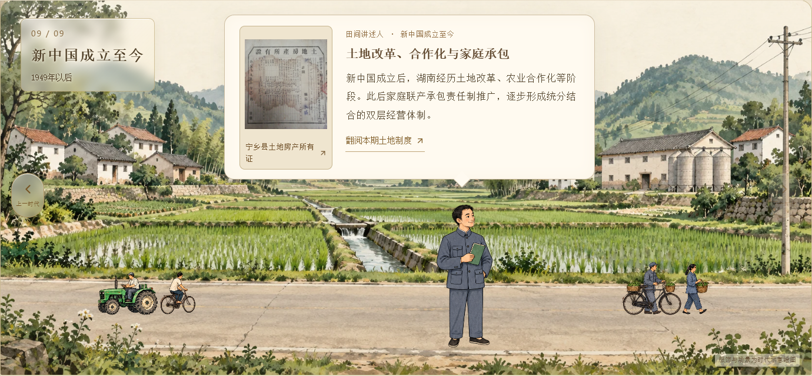
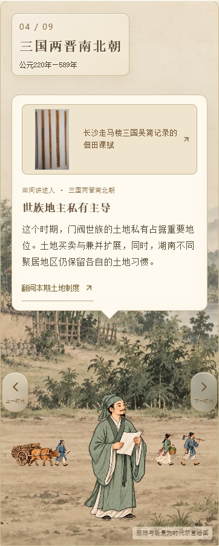

# CSZ2 副本：道路人车比例与位置

日期：2026-10-12。仅维护并发布 AsukaNeko-39/csz2-timeline-slideshow 副本。

用户反馈人车偏大、落点靠近草地，且需要不同组合放在另一侧。九个时代分别校准道路中线；原运输组缩小，新增组合放在道路另一侧，不复制同一幅人车。背景与活动仍先淡出，人物和对话随后退场。

背景图按完整原图1672×941的坐标标记左、中、右道路高度，再根据实际cover缩放及裁切计算可见道路位置。每张图集的透明留白不同，按各格实际脚底、车轮底线对齐，避免把图片外框当成落地位置。人车组宽度上限185px，手机随可用宽度缩小；横向轻摆仅3px，不离开道路。手机切换按钮上移，避开人车。

新增透明WebP素材：`client/public/materials/land-journey/land-road-companions.webp`，1536×1024，保留Alpha。内置image_gen生成，原活动图集仅作风格参考，不编辑或替换原背景和讲述人物。素材为时代示意绘图，不是实物照片。

## 新增组合

| 时代 | 道路另一侧 |
| --- | --- |
| 石器至商周 | 提篮村民、扛稻束农人 |
| 楚国 | 驴驮筐与牵驴农人 |
| 秦汉 | 携简册与背行囊的行人 |
| 三国两晋南北朝 | 提篮村民、扛农具农人 |
| 隋唐五代 | 推筐车农人、圆领衣行人 |
| 宋元 | 挑担商贩、提篮村民 |
| 明清 | 驴驮货、携工具农人 |
| 民国 | 提篮妇女、推货车农人 |
| 新中国成立至今 | 推载筐自行车、提篮村民 |

## 生成提示词

风格参考：原land-activities.webp；新增3×3透明图集，每格一组侧视道路活动，各格完整人物与车辆，古画水墨和矿物色、赭色/灰绿/靛蓝，细而克制的轮廓，不用动漫、3D或写实照片。无文字、标签、边框、地面或背景；每格预留透明空隙，脚和轮底对齐。成人身体自然，车轮不得高过膝到胯部，牛驴大小正常。按上表九组逐代变化，不重复原牛车、驮运队、菜车、人力车或拖拉机组合。生成工具实际各行透明留白不同，网页按脚底数据补偿，没有把提示词所要求的位置当成已经达成的结果。

## 验证

九时代、1600/1024/768/641/640/390/320px七种宽度，两组不同素材分置道路两侧，无遮挡裁切、无横向溢出；逐时代桌面截图检查道路落点，手机检查三国与现代。分层顺序及减少动态效果通过；类型检查和Pages子路径构建通过。

