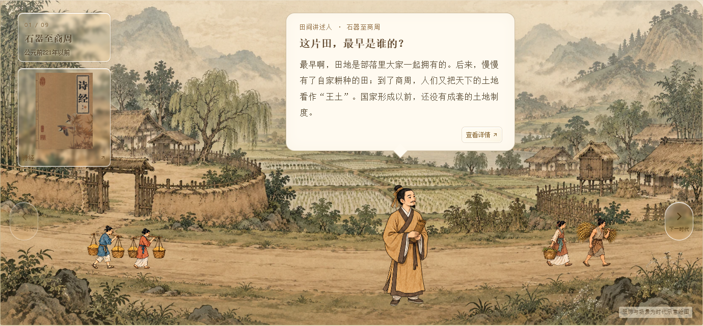
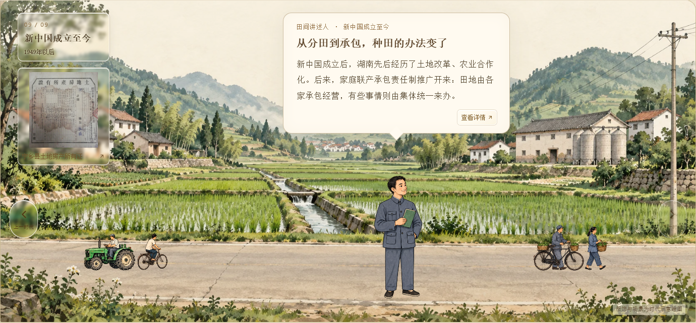
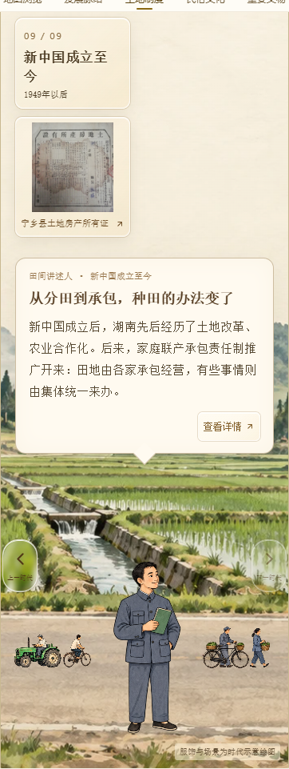

# CSZ2 副本：悬浮资料图与口语化讲述

日期：2026-10-12。仅修改并发布 AsukaNeko-39/csz2-timeline-slideshow 副本。

按用户最新要求，资料图从对话框移到左上角，悬浮在时代标牌下方。时代标牌缩小为桌面最大182px、手机144px；资料图沿用高透明玻璃底，完整展示对应原图，点击可查看该时代资料。左右切换按键向下避开资料图。

九个时代的介绍改成日常讲述的语气，保持现有资料的含义。原资料卡、长文和详情不删改。对话框恢复单栏介绍，继续使用不透明宣纸底色；“查看详情”缩小并对齐右下角。

时代标牌和悬浮资料图作为背景层一起淡出、淡入；退场仍为对话框→人物→背景，入场仍为背景→人物→对话框，保留各段停顿与图片预加载。

验证：九个时代分别在1600、1280、1024、768、641、640、390、320px宽度检查。资料图均在时代标牌下方，与对话框、切换按键不重叠，页面无横向溢出；详情入口位于右下角。图片和详情入口均打开匹配资料，六段切换顺序与背景层同步通过，九张原资料卡保留。类型检查与Pages子路径构建通过。

