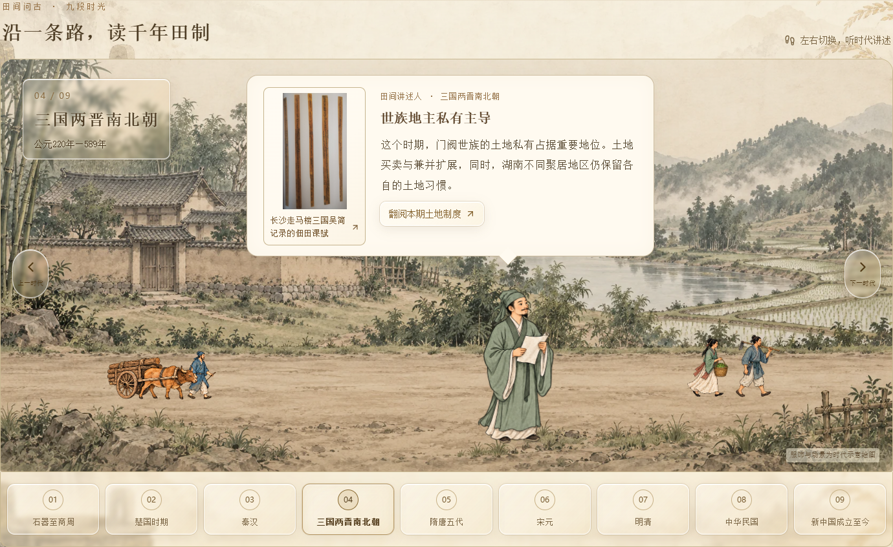
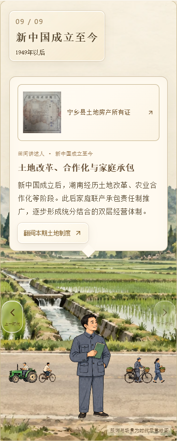

# CSZ2 副本：三层切换与高透明液态玻璃按键

日期：2026-10-12。仅维护并发布 AsukaNeko-39/csz2-timeline-slideshow 副本。

用户明确替换此前“背景先退场”的顺序。现在对话框、讲述人物、背景分别控制；每层完成后留出60–80ms停顿再切下一层。

| 时间 | 退场/入场 |
| --- | --- |
| 0–280ms | 旧对话框消失，人物和背景保持 |
| 340–680ms | 旧人物消失，背景保持 |
| 760–1220ms | 旧背景与道路人车、时代标牌消失 |
| 1300–1760ms | 换时代，新背景与道路人车、时代标牌出现 |
| 1840–2180ms | 新人物出现，对话框仍隐藏 |
| 2260–2540ms | 新对话框出现 |
| 2620ms | 完成切换，恢复按键 |

切换前等待背景与资料图加载；换时代发生在人物和对话框均隐藏时。切换中避免重复启动、禁止开启资料弹窗；首尾时代不越界，键盘方向键仍可使用。减少动态效果设置下直接更新内容，不等待动画。卸载清理全部计时器。

左右时代按键、时代节点、时代标牌和分类筛选改为高透明玻璃：底色约6–22%不透明度、3px轻微模糊与饱和度调整、白色反光边缘、棕金细描边与柔和投影。悬停略增强反光；当前时代用金色边缘和深色字区分。文字和图片本身不降低透明度。对话框仍为不透明宣纸底色。

验证：在实际浏览器中逐段采样背景、人物、对话框透明度，确认六段顺序及未轮到的层保持不变；切换中按键禁用，旧内容在退场前三段不更换。390、320、768px下布局无溢出、对话框不遮挡人物；两组道路活动、九资料卡、对应详情、键盘与减少动态效果均检查。类型检查和Pages子路径构建通过。

