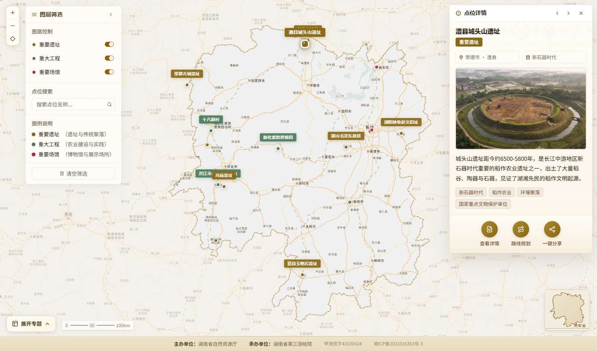
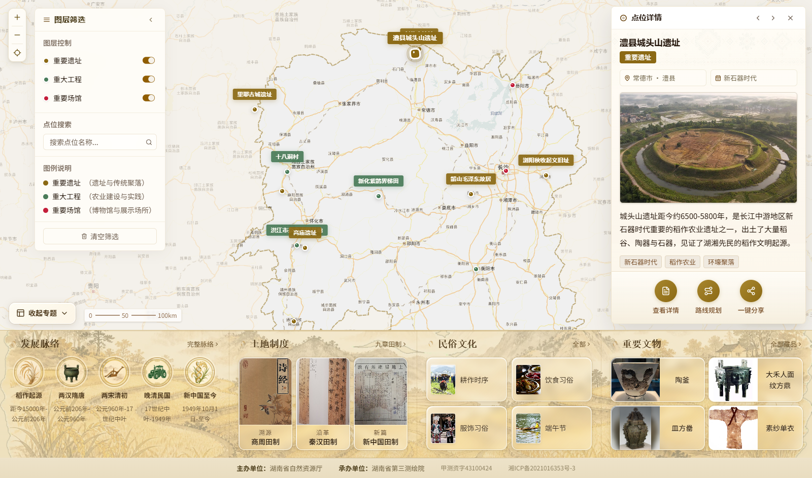
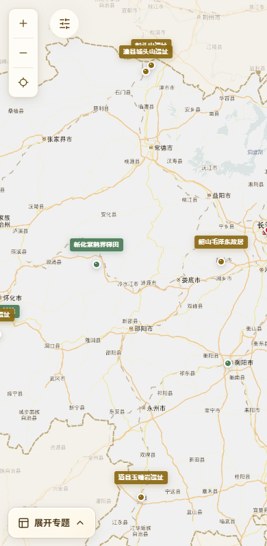
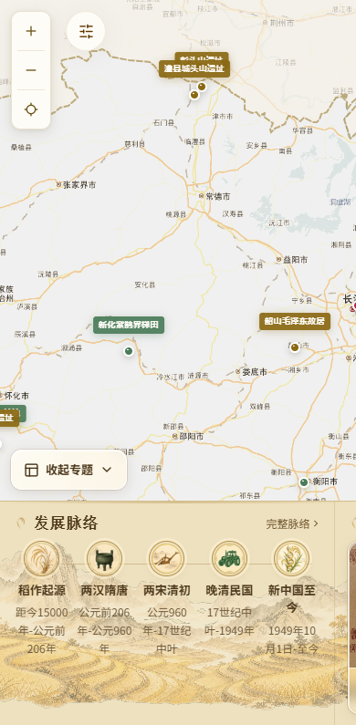

# CSZ2 副本：地图底部专题可收起

日期：2026-10-12。仅维护并发布 csz2-timeline-slideshow 副本。

按用户要求，地图首页下方的发展脉络、土地制度、民俗文化、重要文物改为可展开、收起的面板。每次进入地图先展示3秒，再自动收起；地图随面板平滑收起扩大到腾出的区域。左下角始终保留切换按钮，收起时标为“展开专题”，展开时标为“收起专题”。手动展开后不再自动隐藏，用户可自行收起。

用户开始点击或键盘聚焦专题内容时停止初始预览计时，避免操作过程中面板突然消失。离开地图后清理计时器，返回地图重新开始预览。收起内容使用inert及aria-hidden退出键盘和辅助阅读访问，按钮提供aria-expanded与aria-controls。减少动态效果设置下直接展开、收起，3秒展示规则保持。

四个专题原图片、文字、定向跳转及页尾单位信息保留；展开后手机仍可横向浏览四个专题。地图现有尺寸监听同步调整，比例尺向右移开左下按钮。

验证：类型检查和Pages子路径构建通过。浏览器确认3秒内展示、3秒后收起，地图高度随之增加；点击及键盘可展开、收起，手动展开超过3秒仍保持。四个专题入口分别打开对应栏目，返回地图重新预览。1600、1280、768、390、320px宽度检查按钮可见、可点击，无横向溢出，比例尺与按钮不重叠。

